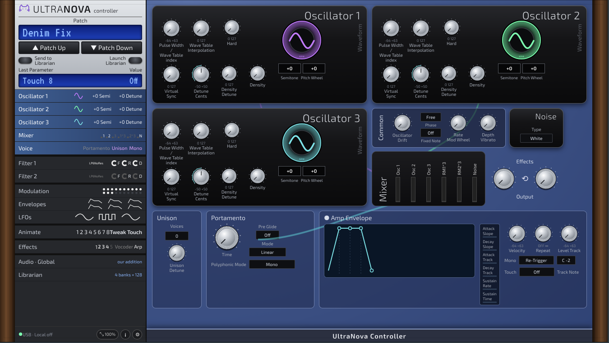

# Linux UltraNova Controller 🐈

Controller plugin for the Novation UltraNova and MiniNova on Linux.

 Screenshot of the real plugin window (Oscillators page).

**Manual:** [PDF, opens in the browser](https://github.com/SpeakingColors/linux-ultranova-controller/blob/main/docs/linux-ultranova-controller-manual.pdf)

## Docs
- [MIDI implementation](docs/MIDI-IMPLEMENTATION.md): CC and NRPN maps.
- [Manual (draft)](docs/MANUAL.md): waveform drag and double-click, mixer, shared controls.

## Status
**Early build, backend v0.2 (not released yet).** A MIDI controller plugin (VST3 and standalone) that sends and receives the CC and NRPN messages listed in [map/params.csv](map/params.csv).

- 483 parameters from Novation's MIDI assignments: 108 CC, 374 NRPN (envelopes, LFOs, FX, EQ, compressors, arpeggiator, gator, vocoder, 20 mod matrix slots, touch and solo controls, global audio setup) and ClockBPM as a 14 bit NRPN. Spare and packed-special NRPNs are left out on purpose.
- The backend follows the rules printed in that document: nrpnMSB is 0 at power-up and after every data entry (so the panel's two-message NRPNs are understood), 14 bit values are sent as dataMSB then dataLSB, other controllers inside a sequence do not break it, touch and solo use 0..63 off and 64..127 on.
- Outgoing messages are queued: the newest value per parameter wins, parameters go out in turn, and an NRPN sequence is never cut in half. At most 48 messages leave per audio block.
- Global / audio setup values are never automated and are not sent by "Send all".
- **None are tested on the real device yet.** Value ranges and names of choices (filter types, waveforms, effects, mod sources) are not in the source, so ranges are assumed 0 to 127 and marked that way in the plugin. No SysEx and no patch librarian yet. Nothing is sent that is not in the map.
- Tests (`sh tests/run.sh`, pure C++, no JUCE): a software model of the device written from the document checks every map entry at its minimum, middle, maximum and default on three MIDI channels, plus decoder, queue, device-inquiry parsing and fuzz runs under address and undefined-behaviour checks. The model checks that our messages follow the document, it is not a recording of the real device.
- Builds in CI on Linux, Windows and macOS. Not tested in a DAW yet.

How it behaves: every entry is an automatable parameter (except Global). Moving it sends MIDI to the device, and incoming CC from the device moves it; incoming CC is consumed, never echoed back. Turn on CC receive and transmit on the device.

Build: `sh tests/run.sh` runs the pure C++ tests. The plugin needs JUCE 8: clone it into `third_party/JUCE`, then `cmake -B build && cmake --build build`. The CC part of the map is edited in `map/params.csv`; the NRPN part is generated by `python3 tools/gen_map.py`.

  

☕ Free and open source, made by one person. If it helps your music, a coffee on [Ko-fi](https://ko-fi.com/studio87) keeps it coming. 💜

## Docs
- [Interactive mockups](docs/README.md)
- [Roadmap](ROADMAP.md)

## License
AGPL-3.0-or-later, see [LICENSE](LICENSE).

Not affiliated with or endorsed by any hardware maker named here. All trademarks belong to their owners.
